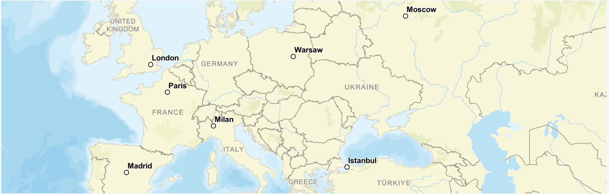

# Introduction

# SAP-GEOMAP (`ui5-geomap`)

`ui5-geomap` is an SAP Web Component leveraging the UI5 Web Components framework. It is built on top of [UI5 Web Components](https://github.com/SAP/ui5-webcomponents/) and is meant to serve as a tool for visualizing a map with vector tiles and geospatial data.

The SAP Geomap component can be used with any HTML-based web UI framework.

SAP Geomap is a web component that can visualize GeoJSON data from various map/tile providers like ESRI, MapBox, Azure maps, SAP HSS, etc.

It can mix the tiles provided by the map provider and GeoJSON describing features ad layers
coming from another source(s) and visualize the different layers to represent these features.
Some of the main map features are:

- Visualize, pan, zoom, rotate, tilt the map
- Supports different features like point, line string, polygon, etc.
- Highly customizable markers on the fly
- Clustering of objects on the map when zoom in/out
- Fly to/perfect zoom
- Showing scale and copyright info
- Selection of objects
- Various events to allow the app to implement context menu, act on pan/zoom, map rendering,
  etc.

:::warning 
The component is in an initial experimental state.

The component API is not finalized yet. Some APIs may be changed or completely removed. Some modules may be renamed in the future and imports might change.
:::

## Third-Party Software

This project includes the following third-party open source software components. Each component is subject to its own license terms.

| Library | License | Repository | NPM |
|---------|---------|------------|-----|
| maplibre-gl | BSD-3-Clause | [maplibre/maplibre-gl-js](https://github.com/maplibre/maplibre-gl-js) | [maplibre-gl](https://www.npmjs.com/package/maplibre-gl) |
| terra-draw | MIT | [JamesLMilner/terra-draw](https://github.com/JamesLMilner/terra-draw) | [terra-draw](https://www.npmjs.com/package/terra-draw) |
| terra-draw-maplibre-gl-adapter | MIT | [JamesLMilner/terra-draw](https://github.com/JamesLMilner/terra-draw) | [terra-draw-maplibre-gl-adapter](https://www.npmjs.com/package/terra-draw-maplibre-gl-adapter) |
| UI5 Web Components | Apache-2.0 | [SAP/ui5-webcomponents](https://github.com/SAP/ui5-webcomponents/) | [@ui5/webcomponents](https://www.npmjs.com/package/@ui5/webcomponents) |
